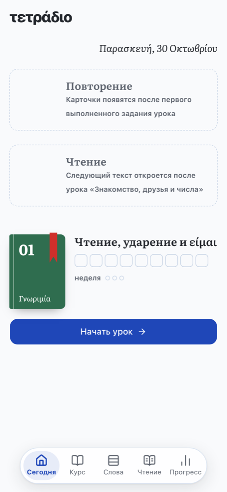
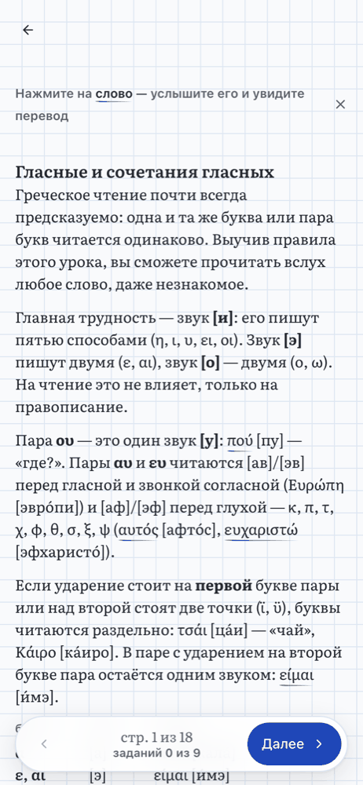
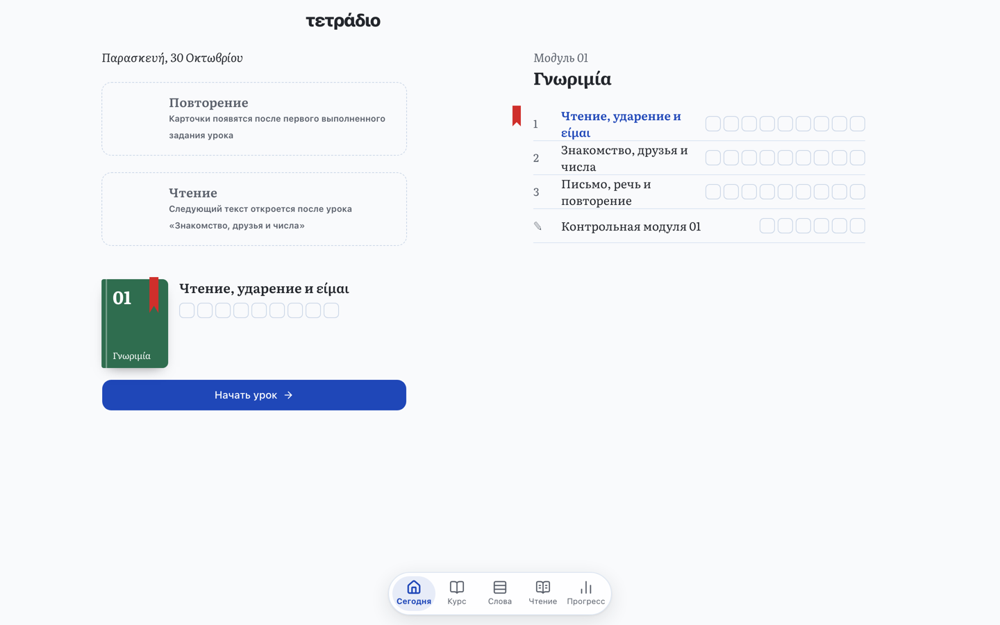

# Τετράδιο

[Русский](README.md) — the main README and all project documentation are in Russian.

[](https://github.com/lavich/tetradio/actions/workflows/ci.yml)
[](LICENSE)
[](https://t.me/TetradioBot)

A notebook for Russian-speaking adults who learn Modern Greek from scratch and prepare for the ΚΕΓ A2 exam in Cyprus. A 24-module course with lessons, reading, listening, writing and flashcard review, delivered as a Telegram Mini App — no separate sign-up.

[Open in Telegram](https://t.me/TetradioBot) · [tetradio.app](https://tetradio.app)

<p>
  
  
</p>



## How it works

- **Step-by-step course:** module → lesson → explanation → practice → checkpoint; flashcards review completed lessons.
- **Works offline:** lessons are stored on the device, answers in a local database.
- **No sign-up:** the Telegram account is the account; progress syncs between devices through Telegram CloudStorage.
- **Spaced repetition:** card schedules use [FSRS](https://github.com/open-spaced-repetition/ts-fsrs).

## Development

```sh
npm ci
npm run dev:mock   # app with a mocked Telegram: http://localhost:5173/app/
npm test           # unit tests
```

More (in Russian): [docs/development.md](docs/development.md), how to contribute — [CONTRIBUTING.md](CONTRIBUTING.md). Security reports: [SECURITY.md](SECURITY.md).

## License

Code and course content — [MIT](LICENSE); third-party materials — [NOTICE](NOTICE).
